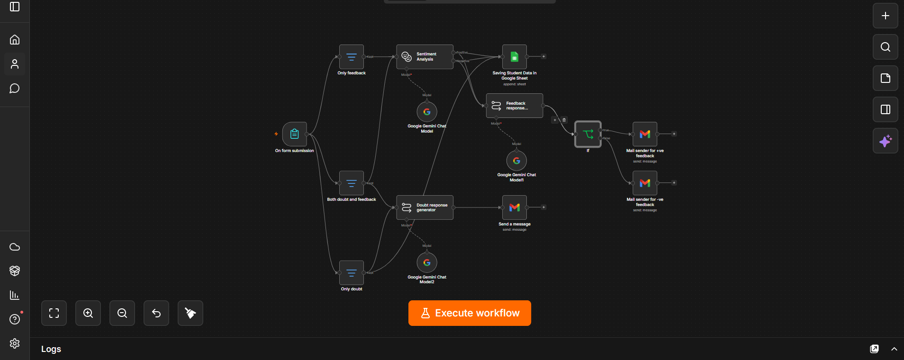
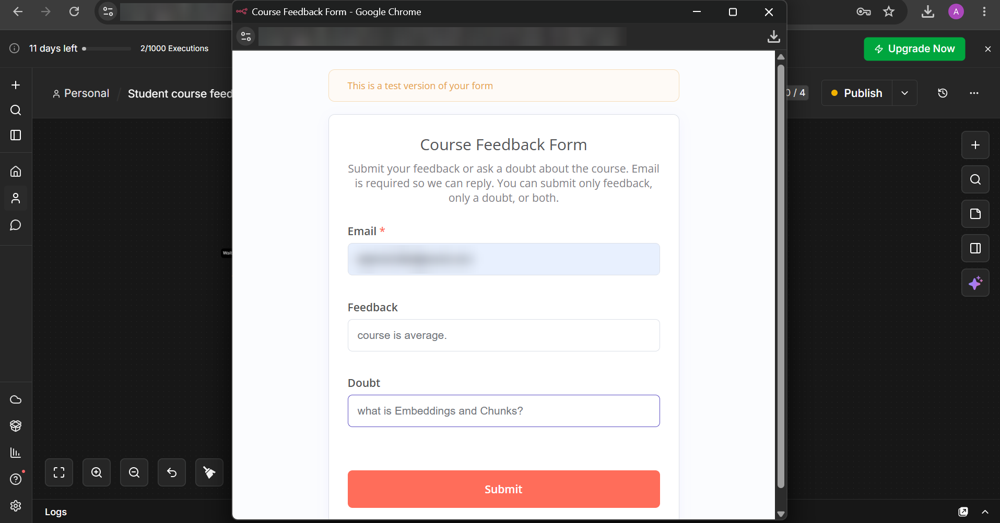
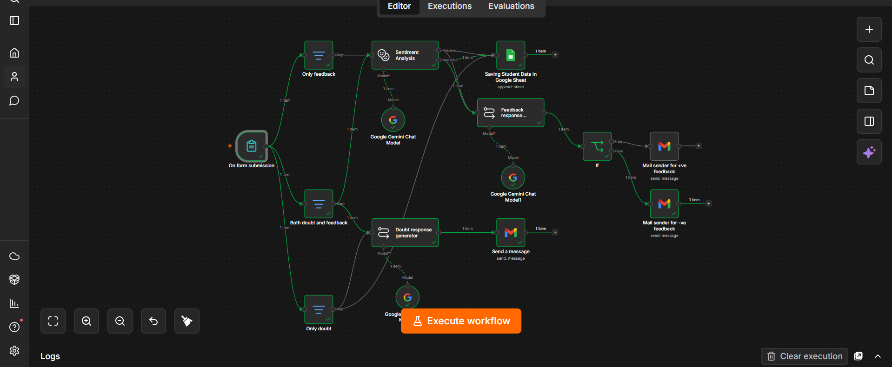
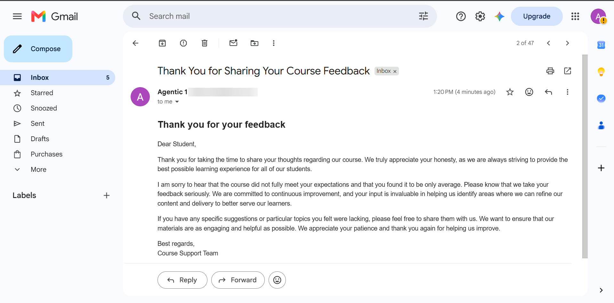
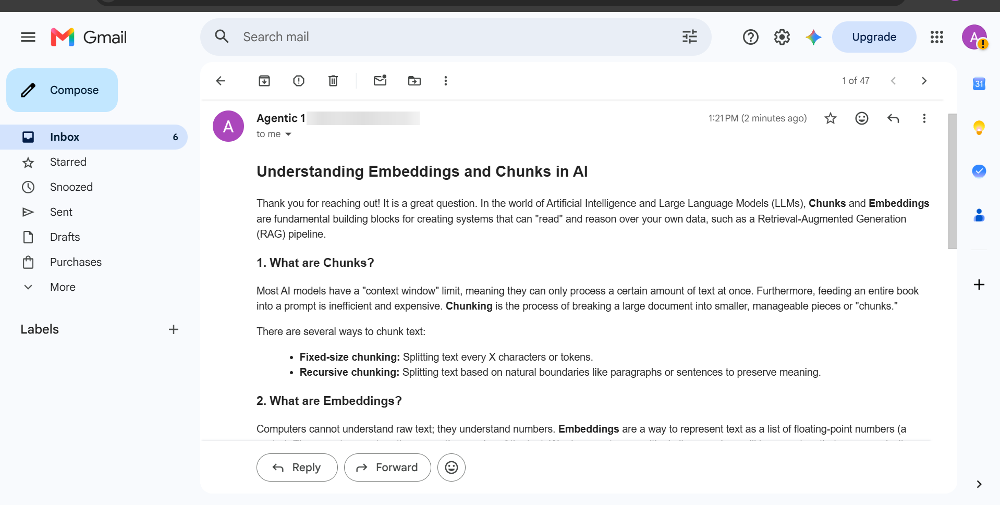
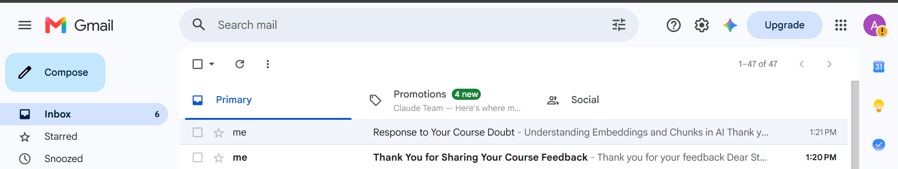

# 🎓 AI Course Feedback & Doubt Response System

An intelligent **n8n** workflow that collects student feedback and course doubts through a form, analyzes feedback sentiment with AI, replies with personalized HTML emails, and logs every submission to Google Sheets.



---

## ✨ Features

- 📝 Student submissions through an n8n Form
- 💬 Handles three cases: **feedback only**, **doubt only**, or **feedback + doubt**
- 🔀 Smart routing with Filter nodes
- 😊 AI sentiment analysis (Positive / Negative) on feedback
- 🤖 Personalized, sentiment-aware replies to feedback
- 📚 Detailed answers to doubts — definitions, step-by-step explanations and code examples
- ✉️ Professionally formatted HTML emails via Gmail
- 📊 Every submission logged to Google Sheets with sentiment and timestamp

---

## 🔄 How It Works

```text
                 ┌─► Only feedback ──────────┐
                 │                           ▼
Form Submission ─┼─► Both doubt & feedback ─► Sentiment Analysis ─┬─► Feedback Response Generator ─► If ─┬─► Gmail (+ve reply)
                 │            │                                   │                                       └─► Gmail (-ve reply)
                 │            │                                   └─► Google Sheets (log)
                 │            ▼
                 └─► Only doubt ─► Doubt Response Generator ─► Gmail (answer)
                         └─► Google Sheets (log)
```

1. **On form submission** – the student enters their email, feedback and/or doubt.
2. **Filters** – route the submission based on which fields were filled.
3. **Sentiment Analysis** – classifies the feedback as Positive or Negative.
4. **Feedback Response Generator** – writes a reply that matches the sentiment.
5. **If** – sends the reply through the positive- or negative-feedback mail sender.
6. **Doubt Response Generator** – writes a clear, detailed answer with examples and code.
7. **Gmail** – sends HTML emails to the student.
8. **Google Sheets** – stores email, feedback, doubt, sentiment and date/time.

---

## 🛠️ Tech Stack

| Tool | Purpose |
| --- | --- |
| n8n | Workflow automation |
| n8n Forms | Student input |
| Google Gemini (`gemini-3.1-flash-lite`) | Sentiment analysis & response generation |
| Gmail | HTML email replies |
| Google Sheets | Submission logging |

---

## 📥 Setup

1. Download [`workflow.json`](workflow.json).
2. In n8n, go to **Workflows → Import from File** and select it.
3. Add your credentials:
   - **Google Gemini (PaLM) API** for the *Google Gemini Chat Model* nodes
   - **Gmail OAuth2** for the mail-sender nodes
   - **Google Sheets OAuth2** for *Saving Student Data in Google Sheet*
4. Point the Google Sheets node to your own spreadsheet with columns for **Email, Feedback, Doubt, Sentiment, Date & Time**.
5. Activate the workflow and share the form URL with students.

### Form fields

| Field | Type |
| --- | --- |
| Email | Email (required) |
| Feedback | Text |
| Doubt | Text |

---

## 📸 Screenshots

| Submission form | Execution |
| --- | --- |
|  |  |

| Feedback response | Doubt response |
| --- | --- |
|  |  |



---

## 🎯 Use Cases

- Online courses & coding bootcamps
- Universities and learning platforms
- AI-powered student support
- Course feedback automation

---

## 🚀 Future Improvements

- 📎 File attachment support
- 🌍 Multi-language responses
- 📈 Analytics dashboard
- 🎫 Ticket generation for unresolved doubts
- 🔔 Slack / Discord notifications
- 🧠 RAG for course-specific answers

---

## 📜 License

This project is licensed under the [MIT License](LICENSE).
